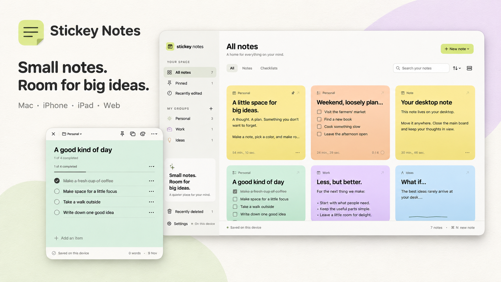

# Stickey Notes



A notes app for Mac, iPhone, iPad, and the web, with rich text, checklists, drawings, and floating desktop notes on macOS. Notes are stored locally, with optional iCloud sync through CloudKit's private database.

The native apps use SwiftUI, AppKit, and UIKit. The offline-capable web app uses browser JavaScript without a framework. All clients share the same archive format.

## Features

- Notes and checklists with autosave, search, groups, pins, and grid/list layouts.
- Rich text formatting, font choices, text sizing, and 25 note colors.
- Drawing over note text with adjustable pens, an eraser, undo/redo, and PNG export.
- Version history, restore, duplication, recoverable deletion, and JSON backup/import.
- Encrypted native note locks using Apple’s system Touch ID / Face ID or device password/passcode prompt. Protected notes automatically lock after two minutes; choose 30 seconds to 15 minutes in Settings. Existing note PINs/passwords remain supported.
- QR generation and export, image scanning, and camera scanning on supported iPhones and iPads. Browser barcode support varies; QR image scanning includes an offline fallback.
- Editable, draggable, resizable Mac desktop notes that restore their positions on relaunch. Choose **Keep on desktop** from a note; closing its desktop window keeps the note in your library.
- Small, medium, and large WidgetKit widgets. Protected notes are excluded from widget previews.
- Optional private iCloud sync with offline merging and interrupted-upload recovery.

Browsers do not support native Apple widgets or the native Apple authentication dialog. Browser-created PIN/password locks work across clients. Apple-authenticated locks use a device-only Keychain credential and can be unlocked on the Apple device that created them; other clients preserve their ciphertext. Storage capacity depends on the device or browser; the app imposes no artificial note-count limit.

## Requirements

- **Native apps:** macOS 14+ or iOS/iPadOS 17+, with Xcode and a Swift 5.9+ toolchain for development.
- **Web app:** a modern browser and Python 3 for the local preview server. Node.js 20+ is used for builds and tests.
- **Apple note authentication, optional iCloud sync, and widgets:** an Apple Developer account and provisioned app targets (plus the extension target for widgets).

## Run it

Run the following commands from the repository root unless noted otherwise.

### Mac

```sh
zsh scripts/build-mac.sh
open 'build/Stickey Notes.app'
```

This builds the **StickeyNotePreview** scheme and produces a signed local app with Apple note authentication, editing, drawings, QR tools, and floating desktop windows. The preview uses development team `8ZA2YW2U9D`; the full app and widget targets retain their own signing configuration. The first build uses the Apple developer account configured in Xcode to register the Mac and create a development profile for `com.stickeynote.app.preview`; subsequent builds reuse the profile. Apple note locking requires this profile and its Keychain entitlement—ad-hoc signing cannot access the protected key store. The preview keeps iCloud unavailable; iCloud and widgets use the full **StickeyNote** scheme. It retains the preview bundle identifier and existing local notes location. Keep the signing team stable after creating Apple-locked notes, because changing teams changes access to their Keychain credentials.

If Xcode reports **PLA Update available**, the team's Account Holder must accept the latest agreement in the [Apple Developer account](https://developer.apple.com/account), then rerun the build. To use another configured team, pass `DEVELOPMENT_TEAM=YOUR_TEAM_ID` to the build script. A failed signing build leaves the existing app in place.

### iPhone / iPad / provisioned Mac

Open `StickeyNote.xcodeproj`, choose the **StickeyNote** scheme, and select your device. In **Signing & Capabilities**, select your own development team for the app and widget targets and configure identifiers registered to your account, then Run. For iCloud and widgets, follow the configuration steps below.

When adding Swift files, regenerate the project with `python3 scripts/generate-project.py`. Update the generator's signing and bundle identifier settings to match your configuration before regenerating, since it rewrites the Xcode project.

### Web

```sh
cd Web
python3 -m http.server 5173 --bind 127.0.0.1
```

Open `http://127.0.0.1:5173`. No package installation is needed. From `Web/`, run `node build.mjs` to produce static `dist/` output, which can be served over HTTPS. Install from supporting browsers for offline use after the first load. Fonts and QR libraries are vendored locally.

On Mac you can also double-click **Start Web App.command** to start the local server and open the app. Keep its Terminal window open while using the web app.

See [the web app guide](Web/README.md) for browser features, storage, and deployment details.

## Optional iCloud and widget setup

Local editing does not require cloud configuration. To enable iCloud or distribute widgets, configure resources under your own Apple Developer account:

1. Select your development team for both Xcode targets and register unique app and widget bundle identifiers.
2. Register a CloudKit container and an App Group. Enable CloudKit for the app and App Groups for both targets. Update the app and widget entitlements, the container identifier in `Sources/StickeyNote/Integrations/CloudKitSyncService.swift`, and the App Group identifier in `Sources/StickeyNote/Integrations/WidgetSnapshot.swift` to match your resources. Keep `scripts/generate-project.py` consistent with your Xcode settings.
3. Create the private-database schema below in CloudKit Console. Deploy it to production for release builds.
4. Create a CloudKit web API token restricted to the deployed web origin and its sign-in redirect, then configure `Web/config.js`. This public app token is not an Apple password or server private key.
5. Build with automatic signing. Enable iCloud in app Settings and sign in on the web with the same Apple account. Match development/production environments between clients.

| Record type | Fields | Index |
| --- | --- | --- |
| `StickeyWorkspace` | `archive`: String, `modifiedAt`: Date/Time, `deviceName`: String | `recordName`: QUERYABLE |
| `StickeyWorkspaceChunk` | `archive`: String | None |

```js
window.STICKEY_CLOUD_CONFIG = {
  containerIdentifier: 'iCloud.com.example.stickeynote', // Replace with your container.
  apiToken: 'YOUR_CLOUDKIT_WEB_API_TOKEN',
  environment: 'development'
};
```

Use your actual local or deployed web origin in CloudKit's allowlist. Keep Apple account credentials and server private keys out of source control and browser code.

See [the integration guide](Sources/StickeyNote/Integrations/README.md) for protocol, signing, widgets, and recovery details.

## Security and persistence

In the native app, choose **Lock note** in a note’s toolbar or menu. Apple’s system prompt verifies you with Touch ID or your Mac login password, or Face ID / Touch ID or your iPhone/iPad passcode. There is no separate note PIN setup, and the app never receives the device password. **Unlock** opens the same system authentication flow. Locked notes hide their title, content, and history. Existing note PIN/password locks continue to work; after unlocking, choose **Use Apple authentication** in Lock settings to convert them without exposing plaintext backups.

The auto-lock timer starts after each successful unlock and defaults to two minutes, including while editing. Choose **Auto-lock after** in Settings or the note's lock settings to change the interval for protected notes on this device. Changes apply to notes that are already unlocked; shortening the interval can lock them immediately. The preference is saved locally. Backgrounding also locks protected notes.

Note protection uses PBKDF2-HMAC-SHA256 (600,000 iterations, random 16-byte salt), AES-256-GCM, and note-ID authenticated data. New native locks generate a random 256-bit credential stored in the device-only Keychain with `userPresence` access control. A fresh `LAContext` uses `deviceOwnerAuthentication`; the authenticated context retrieves the Keychain credential, and is then invalidated. Apple provides the biometric and device password/passcode fallback UI. Decrypted content stays in memory while unlocked; saves, backups, and sync receive ciphertext. Locking cancels in-flight unlock results.

Apple lock credentials never sync or appear in backups. Apple-locked notes and their backups require the original device’s Keychain; loss of that credential cannot be recovered. Protected duplicates retain the same credential reference, so keys are kept for older backups and copies. Browser PIN/password notes and legacy native locks retain the existing encryption format; their PINs/passwords cannot be recovered.

Saves are debounced and backed up, with atomic native writes. Damaged files are preserved for recovery. CloudKit commits a manifest only after all immutable chunks are saved and verifies SHA-256 when reading. Protection transitions have separate revisions so newer stale plaintext metadata cannot silently remove a lock. Cloud sync is bound to the selected Apple account.

This is not an independent security audit. Previously exported plaintext backups and offline-device copies cannot be erased remotely. Interrupted cloud uploads can leave unreferenced chunks requiring storage cleanup.

## Verify

```sh
swift test
node --test Web/test.mjs Web/cloud.test.mjs
node Tests/CloudInterop/verify.mjs
xcodebuild -project StickeyNote.xcodeproj -scheme StickeyNote \
  -destination 'generic/platform=macOS' -derivedDataPath build/xcode CODE_SIGNING_ALLOWED=NO build
xcodebuild -project StickeyNote.xcodeproj -scheme StickeyNote \
  -destination 'generic/platform=iOS Simulator' -derivedDataPath build/xcode-ios CODE_SIGNING_ALLOWED=NO build
```

Tests cover persistence/recovery, PIN validation, encryption, auto-lock deadlines and settings, background-lock races, history, deletion, conflict ordering, chunk integrity, failed uploads, and Swift/JavaScript interoperability. Live iCloud, physical-device Touch ID / Face ID/camera, and installed widget behavior still require provisioned-account/device validation.

## Acknowledgments

The design and features are inspired by [Sticky Notes Widget](https://stickynoteswidget.com/). This is an independent implementation. Third-party web components and their licenses are listed in [the web app guide](Web/README.md#third-party-components).
